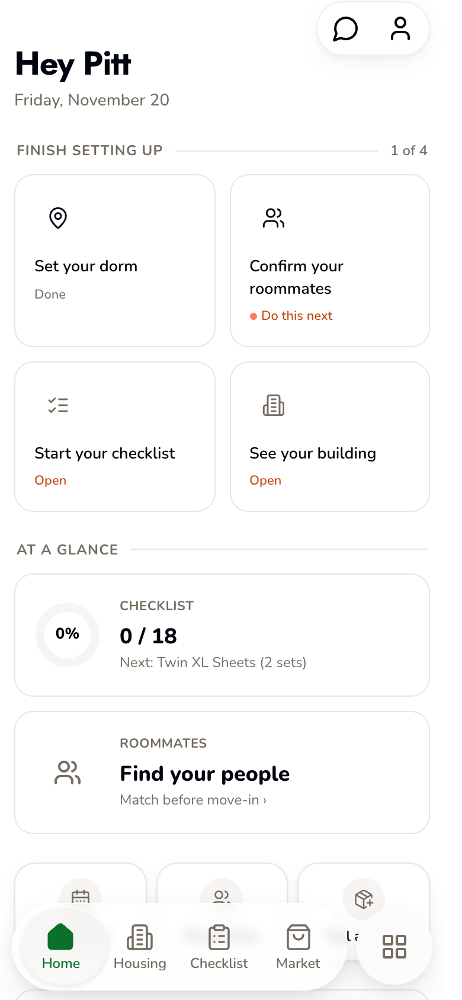
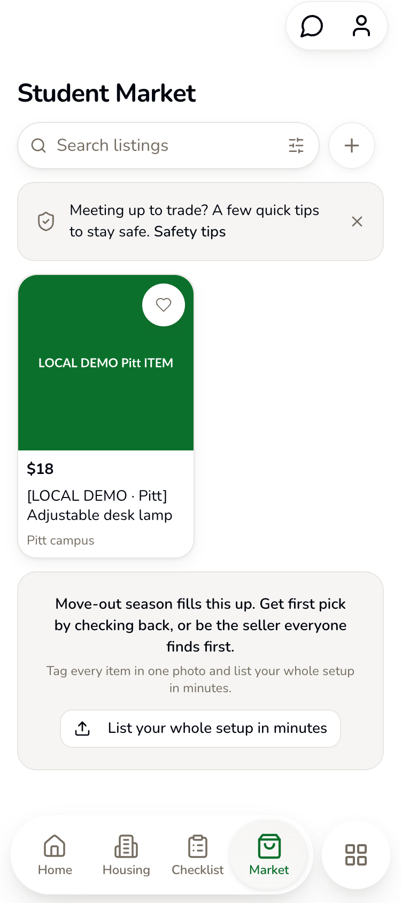
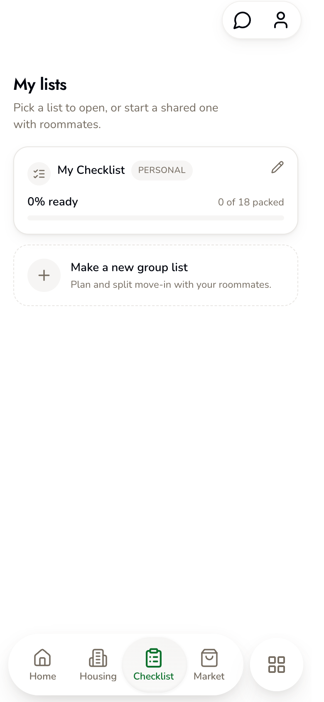

# DormCheck

**A student housing and move-in app built for Pitt and Carnegie Mellon.**

DormCheck helped students explore housing, coordinate move-in with roommates, and buy or sell dorm gear through a campus-only marketplace. It reached **80+ student signups** across both universities. I designed and built it as a solo founder.

## Product screenshots

These screens were captured with fictional demo data.

| Home | Campus marketplace | Move-in checklist |
| --- | --- | --- |
|  |  |  |

## What I built

- A housing explorer, shared move-in checklist, sublease listings, and direct messaging.
- University email verification and campus-scoped access for student accounts.
- A shared React and TypeScript client for web, iOS, and Android, backed by Supabase and Postgres.
- Interactive maps with Mapbox and native mobile builds with Capacitor.

DormCheck was shelved in November 2026. Its hosted services are offline.

[License](LICENSE)

## Run the original product logic locally

Clone this repo and run `node --experimental-strip-types demo.ts` with Node.js 22.18 or later. The demo uses fictional data and needs no dependencies, accounts, or API keys.

| Source | What it demonstrates |
| --- | --- |
| [Roommate matching](roommateMatch.ts) | Scores lifestyle fit, dealbreakers, shared interests, and housing preferences. Returns reasons, conflicts, and a confidence rating. |
| [Roommate preferences](roommateOptions.ts) and [academic-year logic](academicYear.ts) | Defines survey responses and helps interpret class-year context. |
| [Checklist importer](parseChecklistNotes.ts) | Converts pasted notes into checklist items, preserving completed items and associated links. |
| [Housing normalization](housing-match.ts) | Normalizes residence hall and floor labels for consistent matching. |
| [Demo](demo.ts) | Runs selected flows using fictional student and checklist data. |

The five source modules come from DormCheck's original code. The roommate matcher uses relative imports here so it can run outside the original app. The full UI, backend, and deployment configuration are outside this showcase.

## Explore the original web app

[Download the web source snapshot](dormcheck-web-source.tar.gz) to browse the React and TypeScript routes, components, styles, source tests, and Supabase client types behind the screenshots. The archive includes a tested build command and documents the services needed for signed-in features.

### Browse the original implementation on GitHub

| Original source | What to look for |
| --- | --- |
| [Checklist page](ChecklistPage.tsx) | How move-in, move-out, shared lists, and roommate groups fit into the app's checklist screen. |
| [Checklist readiness view](ChecklistReadinessView.tsx) and [helpers](checklistHelpers.ts) | How the interface handles item states, readiness, and checklist interactions. |
| [Product walkthrough](PhoneDemo.tsx) and [feature showcase](FeatureShowcase.tsx) | The original React components that present the app's home, checklist, marketplace, and messaging flows. |
| [Roommate matching tests](roommateMatch.test.ts) | Original regression cases for compatibility scoring and sparse answers. |

These excerpts retain the original imports so you can trace them in the source archive, which preserves the web client's directory structure.

## Try the original product walkthrough

[Download the offline walkthrough](dormcheck-offline-demo.html), then open the downloaded HTML file in a browser. Choose Home, Checklist, Marketplace, or Messages to explore the original animated walkthrough, or use the feature tabs below it. The demo uses sample content and has no sign-in or live backend.

[Walkthrough source and build instructions](offline-walkthrough-source.tar.gz) are available alongside the original web-client archive.
